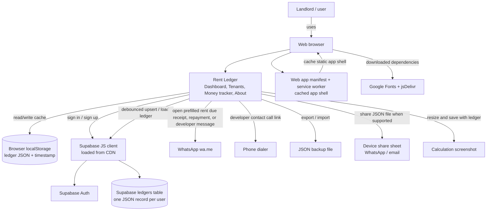

# Architecture

Rent Ledger is implemented as a single static page. The UI, business rules, local persistence, authentication, and cloud-sync client are all in `index.html`; there is no separate application server in this repository.

## Runtime flow

1. On startup, the app checks whether the Supabase client is available. If it is unavailable, the browser-local ledger is loaded.
2. When Supabase is available, the sign-in overlay is shown. A valid session selects an account-specific local-storage key and loads the cached ledger.
3. The app fetches the signed-in user's `ledgers` row. If the cloud timestamp is newer than the local timestamp, cloud JSON replaces the local cache; otherwise the local ledger is uploaded. A first sign-in can optionally move the legacy browser-only ledger into the account.
4. Changes are saved to local storage immediately. Authenticated changes are uploaded to Supabase after a short debounce.
5. Reminder and receipt actions construct a WhatsApp URL with a prefilled message. The user must send the message in WhatsApp.
6. The Money tracker stores non-interest loans and one-time/monthly liabilities. A separate Interest loans tab stores a fixed monthly collection amount, separate interest/principal payments, and due reminders in the same ledger document.
7. Backup sharing uses the browser/device share sheet when file sharing is supported. Otherwise, the app downloads the JSON backup and asks the user to attach it manually to a WhatsApp message or email.

## Deployment notes

- Serve the app from an HTTPS static web host for mobile installation; `localhost` is supported for development.
- The service worker caches the same-origin app shell only. Authentication, cloud sync, fonts, and messaging integrations still need network access.
- Cloud features depend on the Supabase project configured in the page and the expected `ledgers` table. The project's Row Level Security policies should ensure users can only access their own row.
- No backend/API server or server-side job is part of this repository.
