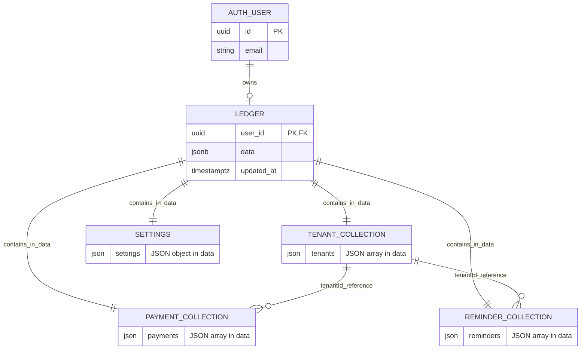

# Database and persisted data

The app does not define relational tenant, payment, or reminder tables. It persists one serialized ledger object in browser `localStorage` and, for signed-in accounts, stores that same object in a single Supabase `ledgers` row.



`TENANT_COLLECTION`, `PAYMENT_COLLECTION`, `REMINDER_COLLECTION`, and `SETTINGS` in the diagram are logical parts of the JSON document, **not separate SQL tables**. `tenantId` is an application-level reference inside JSON; the database does not enforce it as a foreign key.

## Ledger document

```json
{
  "tenants": [],
  "payments": [],
  "reminders": [],
  "settings": {
    "issuedBy": "",
    "seq": 0
  }
}
```

### Logical records

- **Tenant** — `id`, `name`, `phone`, `amount`, `dueDay`, `message`, `flat`, `since`, `agrStart`, `deposit`, `notes`, `photo`, and optionally `noticeAt`. The optional photo is stored as a resized data URL.
- **Payment** — `id`, `tenantId`, `tenantName`, `month` (`YYYY-MM`), `paidOn`, `amount`, `rent`, `note`, and `receiptNo`.
- **Reminder** — `id`, `tenantId`, `month` (`YYYY-MM`), and `sentAt`.
- **Settings** — `issuedBy` and `seq`, used for receipts.

Fields are stored as JavaScript values from the page; several form values such as rent and due day are strings. Imported backups are expected to use the same object shape.

## Storage keys and cloud contract

- Browser-only ledger: `rentLedger.v2`
- Signed-in local cache: `rentLedger.v2.<user-id>`
- Local timestamp: the corresponding key plus `.ts`
- Supabase table contract used by the app: `ledgers(user_id, data, updated_at)`. The app upserts by `user_id` and reads the matching row.

The cloud row should have one row per user, with `user_id` as a primary or unique key and an appropriate foreign key to Supabase Auth. Enable RLS and create policies that limit reads and writes to the authenticated owner (for example, enforce `auth.uid() = user_id` for both visibility and writes). The client-side filter alone does not provide authorization.

All tenant/payment/reminder records are replaced together when the app syncs the ledger document; there is no per-record cloud synchronization or database-level referential integrity between those JSON records.
